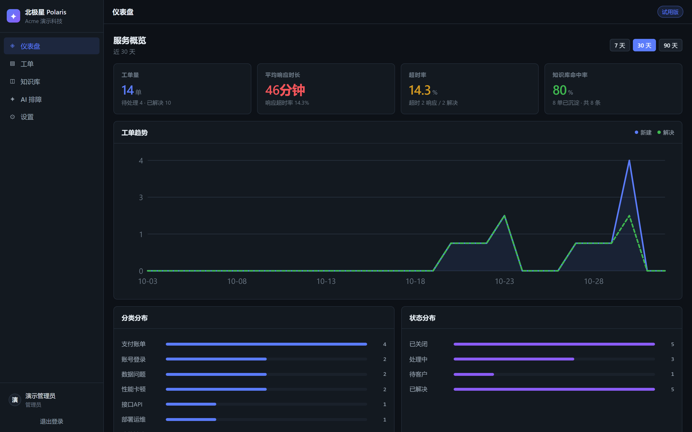

# Polaris 北极星 · Customer Ticket Management Platform

A lightweight ticketing system for small and mid-sized teams: every customer issue gets a record, a response, and a permanent trace.

[](https://github.com/kevin12369/polaris/actions/workflows/ci.yml)
[](https://kevin12369.github.io/polaris/)

**Live demo →** https://kevin12369.github.io/polaris/ (includes mock data, no backend required)

- [中文文档](#readme) · [English](#readme)
- [Roadmap](docs/ROADMAP.en.md) · [API reference](docs/API.en.md)

<p align="center">
  
</p>

---

## Why you need it

Support at a small company usually looks like this: customers ask questions in a WeChat group, the agent scrolls back through chat history looking for an answer, and the fix gets scribbled into a personal notebook. The same question comes back three times a week, nobody can say how fast they actually respond, and when the experienced agent leaves, the knowledge leaves with them.

There are only fifteen people on the team, so buying a proper system never felt necessary.

Polaris pulls those scattered habits into four things:

| Module | What it does |
|---|---|
| **Tickets** | Submit → auto-classify → SLA countdown → status transitions |
| **Attachments** | Screenshot and log uploads (extension + magic-number checks) |
| **Knowledge base** | Promote a resolved ticket to a KB article with one click |
| **AI troubleshooting** | Paste an error → search the knowledge base → get actionable steps |
| **Dashboard** | Ticket volume / avg first response / SLA breach rate / KB hit rate |

## Three things that matter

**It runs on your own server — the data never leaves.** Two containers and a SQLite file. The database *is* a file on disk: back it up by copying it, migrate by copying it. Customer error reports never reach a third party.

**You do not need to buy an AI service.** Classification and retrieval run on local engines out of the box. Plug in any OpenAI-compatible endpoint if you want richer output — and if you don't, every feature still works.

**Ten minutes to first ticket.** One `docker compose up` command, then self-signup in the browser. No implementation project, no training, no consultant.

## Who it fits

- Software vendors, system integrators and small SaaS teams of 5–50 people
- One to three dedicated support engineers, with enough volume that someone eventually asks "how fast are we replying?"
- B2B customers (businesses or stores) whose reports arrive scattered across chat groups

**Not a fit for:** teams already on Zendesk / Tencent Smart Customer Service; companies with fewer than 8 people where the founder handles support personally; and pure staff-augmentation outsourcing firms with no product to maintain.

Stack: FastAPI + Vue 3 + SQLite + Docker.

---

## 1. Running it in ten minutes

### Option A: Docker (recommended)

```bash
git clone https://github.com/kevin12369/polaris.git polaris
cd polaris
cp .env.example .env

# Replace SECRET_KEY with a random string
python -c "import secrets;print(secrets.token_urlsafe(48))"

docker compose up -d --build
```

Open `http://<server-ip>:8080` and click "Create free workspace" to register. The database lives in the `polaris-data` volume and survives container rebuilds.

### Option B: Local development

```bash
# Backend
cd backend
python -m venv .venv
./.venv/Scripts/pip install -r requirements.txt   # Windows
# ./.venv/bin/pip install -r requirements.txt       # macOS/Linux
./.venv/Scripts/python -m uvicorn app.main:app --reload --port 8000

# Frontend (separate terminal)
cd frontend
npm install
npm run dev
```

Frontend at `http://localhost:5173`, API docs at `http://localhost:8000/docs`.

### Seed demo data (optional)

```bash
cd backend
./.venv/Scripts/python -m app.seed --reset
```

Demo account: `demo@acme.com` / `demo1234`

---

## 2. Using the four modules

### Tickets

1. Click **New ticket**, enter a title and description, submit.
2. The system **classifies the issue and assigns a priority**, showing its confidence and reasoning, and searches the knowledge base for articles you may want to reference.
3. The **SLA countdown** on the right runs on priority:
   - P1 critical outage: respond in 30 min / resolve in 4 h
   - P2 severe: respond in 2 h / resolve in 2 days
   - P3 normal: respond in 8 h / resolve in 6 days
   - P4 low: respond in 1 day / resolve in 14 days
   - SLA is measured in **working hours** (Mon–Fri, 09:00–18:00 by default). Nights and weekends do not count.
4. Status transitions are enforced by a state machine: `New → Triaged → In progress → Waiting on customer → Resolved → Closed`. Invalid transitions are rejected.
5. Notes, transitions and SLA settlements are all written to the **timeline**, so it is always clear who did what and when.

> SLA deadlines are **fixed at creation time** based on priority. Changing priority later does not rewrite history, so the statistics stay honest.

### Working hours (Settings)

Not every team works the same week. Under **Settings → Working hours** you can tick the days you staff and set start/end times. New tickets use the new schedule; existing SLA deadlines stay untouched. Only administrators can change it.

### Holidays (since v1.1.0)

Chinese statutory holidays are built in. **Holidays do not count towards SLA countdowns**;
make-up working days do:

- All 2026 statutory holidays and make-up working days are included (from the State Council notice)
- A ticket created during the National Day week starts counting on the first working day after
- Weekend make-up working days (e.g. 10 October) count normally
- You can add your own days off (company shutdowns) and extra working days (on-call shifts)

Years without bundled data fall back to the regular weekday schedule instead of failing.

### Attachments (since v1.2.0)

The ticket detail page accepts screenshots and logs — customers send screenshots, and
describing them in words is slow.

The checks are not just extension-based:

- **Extension *and* file magic number are verified.** Renaming an `.exe` to `.png` is rejected.
- **Storage names are random** (`secrets.token_hex(16)`) and contain no user input, which rules
  out path traversal at the root.
- **Downloads are forced as attachments**, with `nosniff` and a CSP sandbox — an uploaded
  HTML/SVG file is never executed by the browser.
- **SVG is not on the allow list** — SVG is XML and can embed scripts.

Allowed: png / jpg / gif / webp / pdf / txt / log / md / csv / json / yaml / xml / zip / docx /
xlsx / pptx. Defaults are 10 MB per file and 10 per ticket, configurable via environment variables.

### Knowledge base

- Write articles by hand, or **promote a resolved ticket** in one click.
- Promoting captures the source ticket number, the category and the resolution, and tries to generate a summary plus generalised troubleshooting steps.
- Retrieval uses BM25 with Chinese-aware tokenisation — no external service required.

### AI troubleshooting assistant

1. Paste the customer's error message (also available per-ticket from the ticket detail page).
2. You get a diagnosis, 3–6 actionable steps, and the articles each step came from.
3. **When nothing matches, it does not invent an answer.** It falls back to a standard checklist for the issue category and prompts you to capture the outcome back into the knowledge base.

Three engine states:

| Engine | Trigger | Behaviour |
|---|---|---|
| `llm+kb` | An LLM endpoint is configured | Steps generated from the retrieved content |
| `kb` | No LLM, but the KB matched | Reuses the article's own steps |
| `fallback` | No KB match | Standard checklist for the issue category |

### Dashboard

Four core metrics plus trends and breakdowns:

- **Ticket volume** — total in range, open, resolved
- **Avg first response** — working-minute basis, only tickets that were actually answered
- **SLA breach rate** — response and resolution breaches tracked separately
- **KB hit rate** — share of resolved tickets linked to a knowledge article. This is the metric that tells you whether institutional knowledge is actually accumulating.

---

## 3. Multi-tenancy and permissions

- Each company gets an independent space; **data is fully isolated** and every query is tenant-scoped.
- Two roles: `admin` (can add members) and `agent`.
- JWT auth with PBKDF2 password hashing (120k rounds). Secrets come from environment variables, never from the code.

### Adding an agent

```bash
curl -X POST http://<host>:8000/api/auth/members \
  -H "Authorization: Bearer <admin_token>" \
  -H "Content-Type: application/json" \
  -d '{"name":"Alex","email":"alex@company.com","password":"initial-password","role":"agent"}'
```

---

## 4. Connecting an LLM (optional)

Everything works without it. Configure any OpenAI-compatible endpoint to improve three things:

```bash
LLM_BASE_URL=https://api.deepseek.com/v1
LLM_API_KEY=sk-xxxx
LLM_MODEL=deepseek-chat
```

1. Ticket classification gets a second opinion from the model
2. Troubleshooting steps are written from the retrieved content
3. Knowledge summaries and generalised steps are generated on promote

Any LLM failure falls back to the local engine — ticket flow is never blocked.

---

## 5. API reference

| Method | Path | Purpose |
|---|---|---|
| POST | `/api/auth/register` | Self-signup (creates a company space) |
| POST | `/api/auth/login` | Log in |
| GET | `/api/auth/members` | List members |
| POST | `/api/auth/members` | Add an agent (admin only) |
| GET | `/api/settings/work-schedule` | Read the working-hours schedule |
| PUT | `/api/settings/work-schedule` | Update the working-hours schedule (admin only) |
| GET | `/api/tickets/meta` | Category / priority / status dictionaries |
| POST | `/api/tickets` | Submit a ticket (auto-classify + KB suggestions) |
| GET | `/api/tickets` | List tickets with filters |
| GET | `/api/tickets/{id}` | Ticket detail + timeline |
| PATCH | `/api/tickets/{id}` | Override category / priority / assignee |
| POST | `/api/tickets/{id}/status` | Change status |
| POST | `/api/tickets/{id}/comment` | Add a note |
| POST | `/api/tickets/{id}/suggest` | Search the knowledge base for a ticket |
| POST | `/api/tickets/{id}/promote-to-kb` | Promote to a knowledge article |
| GET | `/api/kb` | List / search articles |
| POST | `/api/kb` | Create an article |
| PUT/DELETE | `/api/kb/{id}` | Edit / delete an article |
| POST | `/api/assistant/troubleshoot` | Error → troubleshooting steps |
| GET | `/api/assistant/status` | Engine status |
| GET | `/api/dashboard` | Dashboard data |
| GET | `/api/health` | Health check |

Interactive docs: `/docs`

---

## 6. Operations

```bash
# Logs
docker compose logs -f backend

# Back up
docker compose exec backend sh -c "cat /app/data/support.db" > backup-$(date +%F).db

# Restore
docker compose exec -T backend sh -c "cat > /app/data/support.db" < backup-2026-11-02.db

# Restart
docker compose restart backend
```

Health check: `curl http://<host>:8000/api/health`

Full guide: [docs/部署指南.md](docs/部署指南.md) · [English](docs/DEPLOYMENT.en.md)

---

## 7. Tests

```bash
# 1. Start the backend (needed by the e2e suite)
cd backend
./.venv/Scripts/python -m uvicorn app.main:app --port 8100

# 2. Run everything
./.venv/Scripts/python tests/run_all.py
```

Three suites, 93 assertions in total:

| Suite | Assertions | Covers |
|---|---|---|
| `test_sla.py` | 20 | Working-hour maths, weekends, custom schedules, breach detection |
| `test_retrieval.py` | 24 | Retrieval relevance, small-corpus behaviour, EN/CN mismatch, long logs |
| `test_e2e.py` | 49 | All four modules, tenant isolation, state machine, permissions |

The e2e suite uses a unique run id, so it can be run repeatedly without conflicts.

---

## 8. Roadmap

See **[docs/ROADMAP.en.md](docs/ROADMAP.en.md)** for planned features and how they are prioritised.

Roughly:

- **v1.2** — ticket attachments, email and chat ingestion
- **v1.3** — knowledge base version history, duplicate merging, bulk import/export
- **v2.0** — PostgreSQL support, custom fields, webhook subscriptions, audit log

The roadmap is alive — open a [Feature Request](https://github.com/kevin12369/polaris/issues/new?template=feature_request.yml) to discuss.

## 9. Contributing

| Channel | Purpose |
|---|---|
| [Issues](https://github.com/kevin12369/polaris/issues) | Bug reports and feature requests |
| [Discussions](https://github.com/kevin12369/polaris/discussions) | Questions, ideas, show your deployment |
| [CONTRIBUTING.md](CONTRIBUTING.md) | How to submit a pull request |
| [good first issue](https://github.com/kevin12369/polaris/issues?q=is%3Aissue+is%3Aopen+label%3A%22good+first+issue%22) | Friendly entry points for newcomers |

Maintenance is automated: dependencies are updated by Dependabot, stale issues are closed
automatically, release notes are assembled from merged pull requests, and a full verification
runs every Monday.

## 10. Known limitations

- Single-instance SQLite deployment. Fine up to ~50 people; move to PostgreSQL beyond that.
- No file attachments on tickets — descriptions and error text only.
- No inbound email or chat ingestion yet; `POST /api/tickets` is the integration point.
- Bundled holiday data currently covers 2026 only (`backend/app/holidays.py`).
- Attachments are not virus-scanned — only the type allow list and magic-number check are applied.
- Email/chat ingestion needs a webhook on your side (`POST /api/tickets` works as the endpoint).
- The demo page is static with mock data; the real UI needs the backend.

## License

MIT
