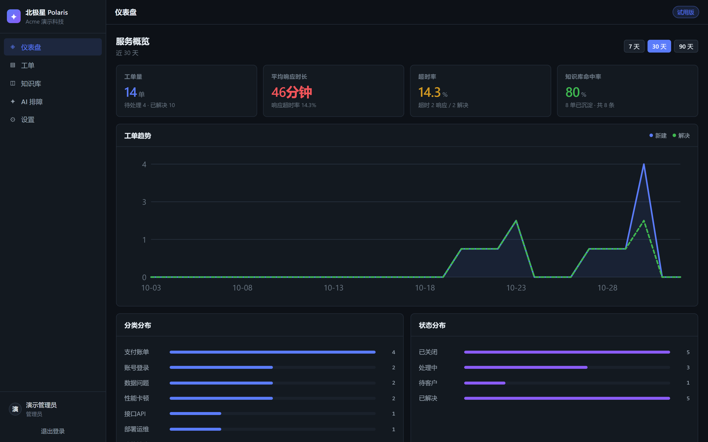

# Polaris 北极星 · 客服工单管理平台

给中小企业的轻量级工单系统：让客户的每个问题都有记录、有回应、有沉淀。

[](https://github.com/kevin12369/polaris/actions/workflows/ci.yml)

<p align="center">
  
</p>

---

## 为什么需要它

小团队的客户服务通常长这样：客户在微信群里问问题，客服翻聊天记录找答案，
解决完随手记在个人电脑上。问题重复问、响应快慢说不清、
老员工一走经验就断了 —— 但因为「团队才十几个人」，一直没觉得需要买套系统。

Polaris 把这套散落的做法收拢成四件事：

| 模块 | 做什么 |
|---|---|
| **工单** | 提交 → AI 自动分类 → SLA 倒计时 → 状态流转 |
| **知识库** | 关单时一键「沉淀为知识库」，下次同类问题直接复用 |
| **AI 排障助手** | 输入报错 → 检索知识库 → 输出可执行排查步骤 |
| **仪表盘** | 工单量 / 平均响应时长 / 超时率 / 知识库命中率 |

## 三个关键特点

**装在自己服务器上，数据不出门。** 两个容器 + 一个 SQLite 文件，
数据库就是磁盘上的一个文件，随时能备份、能迁移。不用把客户报障内容交给第三方。

**不需要买 AI API。** 工单分类和知识库检索都由本地引擎完成，开箱即用。
若要接入大模型，填一个 OpenAI 兼容接口地址即可（可选，不填功能也完整）。

**十分钟能用起来。** 一条 `docker compose up` 命令，浏览器里自助开通一个
独立空间就能开始录工单 —— 不用等实施、不用培训。

## 适合谁

- 5–50 人的软件服务商、系统集成商、SaaS 小团队
- 有 1–3 个专职售后/技术支持岗，问题量已到「需要统计」的程度
- 客户是 B 端（企业/门店），报障分散在各个微信群里

**不适合**：已经在用 Zendesk / 企点 / 腾讯云智能客服等成熟客服系统的团队；
人数少于 8 人且客服是老板兼职；以及以人头计费的纯外包派遣公司。

技术栈：FastAPI + Vue 3 + SQLite + Docker。

---

## 一、10 分钟跑起来

### 方式 A：Docker（推荐）

```bash
git clone https://github.com/kevin12369/polaris.git polaris
cd polaris
cp .env.example .env

# 改掉 .env 里的 SECRET_KEY
python -c "import secrets;print(secrets.token_urlsafe(48))"

docker compose up -d --build
```

打开 `http://<服务器IP>:8080`，用「免费开通」自助注册一个企业空间即可开始用。

数据存在 Docker 卷 `polaris-data` 里，容器重建不丢。备份就是把整个卷复制出来。

### 方式 B：本地开发

```bash
# 后端
cd backend
python -m venv .venv
./.venv/Scripts/pip install -r requirements.txt   # Windows
# ./.venv/bin/pip install -r requirements.txt       # macOS/Linux
./.venv/Scripts/python -m uvicorn app.main:app --reload --port 8000

# 前端（另开终端）
cd frontend
npm install
npm run dev
```

前端 `http://localhost:5173`，API 文档 `http://localhost:8000/docs`。

### 灌入演示数据（可选）

```bash
cd backend
./.venv/Scripts/python -m app.seed --reset
```

演示账号：`demo@acme.com` / `demo1234`

---

## 二、四个模块怎么用

### 工单

1. 点「＋ 新建工单」，填标题和描述，提交。
2. 系统**自动判定分类和优先级**，并同时检索知识库，把可能相关的条目直接推给你。
3. 右侧 **SLA 倒计时**按优先级实时走表：
   - P1 致命中断：响应 30 分钟 / 解决 4 小时
   - P2 严重：响应 2 小时 / 解决 2 天
   - P3 一般：响应 8 小时 / 解决 6 天
   - P4 低：响应 1 天 / 解决 14 天
   - SLA 按**工作时间**计算（默认周一至周五 09:00–18:00），周末和晚上不计入。
4. 状态流转严格按状态机走：`待受理 → 已分类 → 处理中 → 待客户 → 已解决 → 已关闭`，非法流转会被拒绝。
5. 备注、状态变更、SLA 结算全部写进「处理记录」，谁在什么时候做了什么都有据可查。

> SLA 截止时间在工单创建时按优先级**固化**。中途改优先级不会重算历史口径，避免统计被事后调整。

### 工作时间表（设置页）

不同小公司的排班不一样（有的周六上班、有的做轮班）。在「设置 → 工作时间表」里可以按需调整：

- 勾选工作日（周一到周日任意组合）
- 设置上下班时间
- 实时预览每周总工时

调整后**新建的工单**按新排班计算 SLA，已有工单的截止时间不变（保持历史口径一致）。

只管理员能改，修改权限有服务端校验。

### 知识库

- 手动新建，或者**关单时一键沉淀**（工单详情页右下角）。
- 沉淀时会自动带上原工单号、分类、处理记录，并尝试调用 AI 生成摘要和**通用化**的排查步骤。
- 检索用 BM25，中文自动切二元组，不依赖任何外部服务。

### AI 排障助手

1. 把客户的报错信息粘进去（也支持在工单详情页里针对单张工单执行）。
2. 输出诊断结论 + 3~6 步可执行排查步骤，每步标注来源条目。
3. **知识库没有匹配时不会瞎编**，而是按问题分类给出标准排查清单，并提示你把结论沉淀回知识库。

三种引擎状态：

| 引擎 | 触发条件 | 表现 |
|---|---|---|
| `llm+kb` | 配置了大模型 | 基于检索内容生成针对性步骤 |
| `kb` | 没配大模型，但命中知识库 | 直接复用条目自带的排查步骤 |
| `fallback` | 知识库也没命中 | 按分类给标准清单 |

### 仪表盘

四个核心指标 + 趋势 + 分布：

- **工单量**：区间工单总数、待处理数、已解决数
- **平均响应时长**：工作分钟口径，只统计已响应工单
- **超时率**：响应超时或解决超时的工单占比（分开统计两个口径）
- **知识库命中率**：已解决工单中关联了知识库条目的比例 —— 这是衡量「经验有没有沉淀下来」的关键指标

---

## 三、多租户与权限

- 每家企业 = 一个独立空间（company），**数据完全隔离**，所有查询都带租户过滤。
- 角色只有两种：`admin`（管理员，可添加成员）、`agent`（坐席）。
- 认证用 JWT + PBKDF2 密码哈希（120k 轮），密钥从环境变量注入，不进代码库。

### 添加坐席

管理员登录后调接口，或直接在系统里用管理员账号发：

```bash
curl -X POST http://<host>:8000/api/auth/members \
  -H "Authorization: Bearer <admin_token>" \
  -H "Content-Type: application/json" \
  -d '{"name":"小林","email":"lin@company.com","password":"初始密码","role":"agent"}'
```

---

## 四、接入大模型（可选）

**不配置也能完整使用**，所有 AI 能力都有本地降级路径。配置后会更好用：

```bash
LLM_BASE_URL=https://api.deepseek.com/v1
LLM_API_KEY=sk-xxxx
LLM_MODEL=deepseek-chat
```

配置后增强三处：工单分类复核、排障步骤生成、知识库摘要与步骤通用化。
任何 LLM 异常都会自动降级，不会阻塞工单流转。

---

## 五、API 一览

| 方法 | 路径 | 说明 |
|---|---|---|
| POST | `/api/auth/register` | 自助注册（自动开企业空间） |
| POST | `/api/auth/login` | 登录 |
| GET | `/api/auth/members` | 成员列表 |
| POST | `/api/auth/members` | 添加坐席（需 admin） |
| GET | `/api/settings/work-schedule` | 读取工作时间表 |
| PUT | `/api/settings/work-schedule` | 修改工作时间表（需 admin） |
| GET | `/api/tickets/meta` | 分类/优先级/状态字典 |
| POST | `/api/tickets` | 提交工单（自动分类 + 知识库建议） |
| GET | `/api/tickets` | 工单列表（多条件筛选） |
| GET | `/api/tickets/{id}` | 工单详情 + 事件流 |
| PATCH | `/api/tickets/{id}` | 人工覆盖分类/优先级/受理人 |
| POST | `/api/tickets/{id}/status` | 状态流转 |
| POST | `/api/tickets/{id}/comment` | 添加备注 |
| POST | `/api/tickets/{id}/suggest` | 检索知识库候选 |
| POST | `/api/tickets/{id}/promote-to-kb` | 沉淀为知识库 |
| GET | `/api/kb` | 知识库列表/检索 |
| POST | `/api/kb` | 新建条目 |
| PUT/DELETE | `/api/kb/{id}` | 编辑/删除条目 |
| POST | `/api/assistant/troubleshoot` | 报错 → 排查步骤 |
| GET | `/api/assistant/status` | 引擎状态 |
| GET | `/api/dashboard` | 仪表盘数据 |
| GET | `/api/health` | 健康检查 |

交互式文档：`/docs`

---

## 六、运维

```bash
# 查看日志
docker compose logs -f backend

# 备份数据库
docker compose exec backend sh -c "cat /app/data/support.db" > backup-$(date +%F).db

# 恢复
docker compose exec -T backend sh -c "cat > /app/data/support.db" < backup-2026-11-02.db

# 重启
docker compose restart backend
```

健康检查：`curl http://<host>:8000/api/health`

### 从旧版本名升级（support-workbench → polaris）

项目改名时同步调整了 Docker 卷名。**如果你之前用旧名部署过，数据卷需要迁移一次**，
否则 `docker compose up` 会起一个空库：

```bash
# 卷全名格式是 <项目目录名>_<卷名>，先用 docker volume ls 确认实际名字
docker volume ls | grep -E "sw-data|polaris-data"

# 1. 先备份旧卷
docker run --rm -v support-workbench_sw-data:/old -v $(pwd):/backup alpine \
  tar czf /backup/old-sw-data.tar.gz -C /old .

# 2. 把旧卷内容复制到新卷
docker compose up -d backend          # 先起一次以创建新卷
docker run --rm -v support-workbench_sw-data:/old -v polaris_polaris-data:/new alpine \
  sh -c "cp -a /old/. /new/"

# 3. 重启后端
docker compose restart backend
```

> 上面命令里的卷名假设项目目录就叫 `polaris` 和 `support-workbench`。
> 如果你的目录名不同，按第 0 步 `docker volume ls` 的实际结果替换。

如果还没部署过（首次使用），跳过这一步即可。

---

## 七、测试

```bash
# 1. 启动后端（e2e 测试需要）
cd backend
./.venv/Scripts/python -m uvicorn app.main:app --port 8100

# 2. 另开终端跑全部测试
cd backend
./.venv/Scripts/python tests/run_all.py
```

三组测试，共 93 项断言：

| 测试 | 项数 | 覆盖内容 |
|---|---|---|
| `test_sla.py` | 20 | 工作时间计算、跨周末、跨下班、自定义排班、超时判定 |
| `test_retrieval.py` | 24 | 小知识库/标准语料的检索判据、正负样本区分、中英错配、长日志 |
| `test_e2e.py` | 49 | 四模块主流程 + 租户隔离 + 状态机 + 权限控制 |

单独运行：

```bash
./.venv/Scripts/python tests/test_sla.py
./.venv/Scripts/python tests/test_retrieval.py
./.venv/Scripts/python tests/test_e2e.py
```

e2e 测试用唯一标识，可重复运行不冲突。

---

## 八、已知边界

- 单实例 SQLite 部署，适合 5–50 人规模。多实例或更高并发需要换 Postgres。
- 工单附件未实现，当前用文字描述 + 报错文本。
- 邮件/微信等渠道接入需自行对接 webhook（`POST /api/tickets` 已可直接收单）。
- SLA 工作时间表硬编码在 `backend/app/config.py`，如需改节假日请自行扩展。
