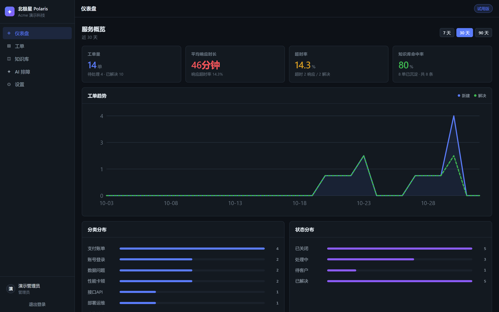

# Polaris 北极星 v1.0.0

给中小企业的轻量级客服工单系统 —— 让客户的每个问题都有记录、有回应、有沉淀。

**在线演示（含模拟数据，无需后端）→ https://kevin12369.github.io/polaris/**

---

## 这是什么

一套装在你自己服务器上的工单系统。四个模块，砍到最小可用：

| 模块 | 做什么 |
|---|---|
| **工单** | 提交 → AI 自动分类 → SLA 倒计时 → 状态流转 |
| **知识库** | 关单时一键「沉淀为知识库」，下次同类问题直接复用 |
| **AI 排障助手** | 输入报错 → 检索知识库 → 输出可执行排查步骤 |
| **仪表盘** | 工单量 / 平均响应时长 / 超时率 / 知识库命中率 |

<p align="center">
  
</p>

## 为什么不一样

**数据在自己手里。** 两个容器 + 一个 SQLite 文件，数据库就是磁盘上的一个文件。
不用把客户报障内容交给第三方。

**不需要买 AI 服务。** 工单分类走本地规则引擎，知识库检索走 BM25，AI 排障助手在
命中时复用条目自带的排查步骤、未命中时给通用清单 —— 全程离线可用。
想接大模型就填一个 OpenAI 兼容接口（可选），接了更好用，不接功能也完整。

**十分钟上线。** `docker compose up -d` 然后浏览器自助开通，不用等实施、不用培训。

**界面双语。** 中英文一键切换，分类/状态/优先级等系统枚举同步切换。

## 快速开始

```bash
git clone https://github.com/kevin12369/polaris.git polaris
cd polaris
cp .env.example .env
python -c "import secrets;print(secrets.token_urlsafe(48))"   # 填入 SECRET_KEY
docker compose up -d --build
```

打开 `http://<服务器IP>:8080`，点「免费开通」即可开始。

**环境要求**：2 核 2G 服务器 + Docker 20.10+。不需要额外的数据库或 AI 服务。

## 技术栈

FastAPI · Vue 3 (Vite) · SQLite · SQLAlchemy 2.0 · Docker Compose

## 质量

- **93 项断言**全部通过（SLA 计算 / 检索相关性 / 端到端主流程）
- CI 覆盖后端测试、前端生产构建、Docker 镜像构建与 compose 配置校验
- 多租户数据隔离已实测：跨租户访问返回 404，不泄露资源存在性

## 已知边界

- SQLite 适合 5–50 人，超过请迁移 PostgreSQL
- 工单暂不支持附件上传
- 邮件/微信自动建单未实现，`POST /api/tickets` 是对接入口
- 工作日历仅覆盖工作日，节假日需自行扩展

## 文档

- [中文 README](README.md) · [English README](README.en.md)
- [部署指南（中文）](docs/部署指南.md) · [Deployment guide (English)](docs/DEPLOYMENT.en.md)
- [更新日志](CHANGELOG.md)

## License

MIT
